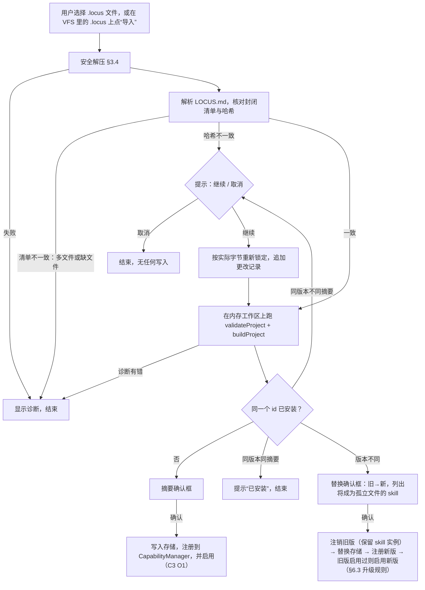

# Capability 安装：.locus 包、导入与持久化（C1）

状态：第 2 版，已由所有者批准（2026-10-17，决定见第 10 节）。放入 `locus-product/docs/CAPABILITY-INSTALL.md`，第 2 节作为 D10 写入 [DECISIONS.md](DECISIONS.md)。
代码基线：locus-runtime `a1921cf`、locus-harness `596e760`、locus-product `24df5eb`。行号均为约数，以函数名为准。

本设计要做到的是：一个 Capability 能以单个 `.locus` 文件的形式分发；用户显式导入之后，它跨页面重载保持已安装、已启用；plugin 以校验过的 wheel 字节进入 Python；skill 以默认内容进入 SourceStore。

本设计不做：

- MCP 的连接与鉴权（C3 单独设计）
- 参考 Capability（C2）
- 由模型触发的安装、市场、远程仓库、签名
- 新增模型可见的工具

---

## 0. 现状（代码事实）

- **包核心**（product `src/capability-package.js`）：`validateProject({ workspace, root })` 与 `buildProject(...)` 读的是一个 `WorkspaceAdapter` 上的项目目录，产出内存里的 `CapabilityBundle`（文件 Map + 规范化的 lock）。没有任何落盘的包格式。上限常量见 CAPABILITY-PACKAGE §2b.4：单个 manifest 256 KiB，skill 源 256 KiB，单个工件 64 MiB，总字节 128 MiB，组件 128 个，文件 256 个。
- **组合运行时**（harness `src/extension-composition.js`）：
  - `CapabilityManager` 的目录只能在构造时传入，或者通过 `replaceCatalogs` 整体替换。后者会清空所有启用状态，并且只有测试在用。
  - 启用状态只存在内存里。
  - plugin 通过 `PluginRuntimeProvider.prepare()` 得到 `{ files: {路径: 源码文本}, imports }`，也就是旧的源码文本合成路径。
  - `buildTaskEnvironment()` 把 payload 放进任务快照并深度冻结；`pythonExtensionKeyOf` 只用 `id@version` 计算 key。
- **runtime**（`src/shell.js` `buildExtensions`）已经支持 wheel 形式的模块：`{ pluginId, wheels: [{ filename, format:'python-wheel', size, sha256, bytes }], imports }`，每个模块恰好一个 wheel。worker 会重新校验 size 与 SHA-256，离线安装、冒烟导入之后才进入 READY。旧的 `files` 形式仍然存在。
- **product 存储**：IndexedDB schema 版本为 3。已有的 `capabilities` 对象库是图片能力注册表在用，与本设计无关。OPFS 的 `mnt/plugins` 目录以 system-read-only 挂载在 `/mnt/plugins`，模型可读。
- **界面**：设置面板里已有 Capability 列表（启用 / 停用 / MCP 的假 Connect 按钮），正式目录为空，只有测试通过 `injectCapabilityCatalogs` 注入。

---

## 1. 目标

1. 一个 `.locus` 文件即一个完整的 Capability，人和模型都能产出。
2. 导入必须由用户显式确认；导入前展示内容摘要。
3. 已安装的包和启用状态跨页面重载保留；每次加载都重新校验内容。
4. 包的元数据和字节存放在模型够不着的地方；元文件不对模型暴露。
5. plugin 只走 wheel 路径；旧的源码文本合成路径删除。

---

## 2. 决定（D10）

1. **分发格式是 `.locus`**：zip 打包，根目录有一个 `LOCUS.md` 元文件。元文件写明包里有哪些文件（路径、大小、SHA-256），以及创建者、创建目的、更改记录。文件清单是封闭的：包里多出或缺少任何文件都拒绝导入。
2. **元文件不对模型暴露**，只用于核验有效性、记录更改和必要字段。创建者名称是自述，不做签名验证。
3. **导入是信任转换**，只能由用户在界面上点击完成；导入来源可以是用户选择的本地文件，也可以是 VFS 里的 `.locus` 路径。
4. **已安装的包与启用状态持久化**。包存放在不挂载进 VFS 的存储里；每次加载重新核对哈希。不一致时提示用户：“继续”等于用当前字节重新锁定并追加一条更改记录，“本次跳过”则本次不加载、包保留。卸载是单独的操作。
5. **版本替换**：同一个 id 的不同版本，确认后覆盖；替换前处于启用状态的，替换后自动启用。skill 实例按 §6.3 的升级规则处理：用户改过的保持原样，没改过的更新为新默认内容；新版本不再包含的 skill，其实例保留为孤立文件，不自动删除。卸载同样保留 skill 实例目录。
6. **plugin 只走 wheel**：删除源码文本合成路径。

归类（D8）：第 4 条中“包存放在模型写不到的地方”和“加载时重新校验”属于 A 类（安全边界，需要对抗测试）；其余属于 B 类。

被取代的旧表述：CAPABILITY-PACKAGE §9（导入只在页面会话内有效）、§10（卸载不是 v1 概念）、§12 中“persistent installed-package catalog”一项；EXTENSION-MODEL §4 中 v1B 待办里“legacy files 路径”一项；CAPABILITY-BOUNDARIES §11.6 中“page-session only”与“incompatible markers fail loudly and the reset path is Remove + Re-add”两项（安装标记机制本身按 D6 保留，只改变标记与当前版本不一致时的处理）。

---

## 3. `.locus` 格式

### 3.1 结构

zip 的内容就是一个 Capability 项目目录（布局见 CAPABILITY-PACKAGE §4），外加根目录的 `LOCUS.md`：

```
LOCUS.md
capability.json
plugins/<id>/plugin.json
plugins/<id>/artifacts/<name>.whl
skills/<id>/skill.json
skills/<id>/SKILL.md
mcp/<id>/mcp.json
```

### 3.2 LOCUS.md

````markdown
# 文本分析参考能力

（创建目的与说明，自由文本，给人看。）

## 更改记录

- 1.1.0（2026-10-20）：top_terms 支持停用词
- 1.0.0（2026-10-17）：首个版本

```locus-manifest
{"schemaVersion":1,"id":"reference-text-analysis","version":"1.1.0","author":"zgzds","purpose":"演示用的文本统计能力","files":[{"path":"capability.json","size":312,"sha256":"…"}]}
```
````

规则：

- 必须恰好有一个语言标记为 `locus-manifest` 的代码块，内容是一个 JSON 对象。字段白名单：`schemaVersion`（必须为 1）、`id`、`version`、`author`（字符串，≤ 200 字符）、`purpose`（字符串，≤ 2000 字符）、`files`（数组）。出现未知字段就拒绝。
- `files` 是**封闭清单**：列出 zip 里除 `LOCUS.md` 以外的每一个文件，每项 `{ path, size, sha256 }`，按路径字典序排列。`LOCUS.md` 本身不在清单里，所以追加更改记录不会让哈希失效。
- 包摘要（digest）= `sha256(canonicalJson(manifest))`，由导入方计算，不写进文件。
- 正文（标题、说明、更改记录）是自由文本，导入时原样保存、在界面上展示，不参与校验。
- `id` 和 `version` 必须与 `capability.json` 里的值一致。

### 3.3 打包

product 提供一个纯函数 `packLocus({ workspace, root, author, purpose, body })`：读取项目目录，先跑 `validateProject` + `buildProject`，然后按上面的期望集合（各组件 manifest + lock 的 `files`）收集文件、计算 `files` 清单，写出 `LOCUS.md`，压成 zip，返回字节。`size` 和 `sha256` 永远由程序计算，不由作者或模型手写。

C1 只提供这个函数（供测试和 C2 的参考 Capability 夹具使用），不做打包界面。模型侧的打包工具属于 Phase D 的编写 Capability（SDK plugin）。

### 3.4 zip 解析规则（宿主侧攻击面）

新模块 `src/locus-archive.js`，不引入依赖：

- 只按**中央目录**解析；本地文件头只用来定位数据，并核对文件名与中央目录一致。
- 压缩方法只接受 0（store）和 8（deflate）；解压用 `DecompressionStream('deflate-raw')`。
- 拒绝：加密条目（通用标志位 0）、zip64、文件名非 UTF-8 且非 ASCII、重复文件名、符号链接（外部属性里 unix 模式为 S_IFLNK）、绝对路径、反斜杠、`.`/`..` 段、控制字符。
- 目录条目（名字以 `/` 结尾）忽略。
- 上限：条目数 ≤ 256 + 1；单个文件解压后 ≤ 64 MiB；解压总量 ≤ 128 MiB；`LOCUS.md` ≤ 256 KiB。先检查中央目录里声明的大小，解压时再按实际字节数计数，超限立即中止（防 zip 炸弹）。
- 每条拒绝都返回带代码的诊断（与包核心 §2b.5 的风格一致），不抛未分类的异常。

---

## 4. 导入流程



- **首次安装自动启用**（所有者 2026-10-18 决定，见 [C3-CREDENTIALS-MCP.md](C3-CREDENTIALS-MCP.md) §3.3）：确认安装后直接启用；启用失败时包保持已安装但停用，并显示原因。启用不会授予任何凭据。版本替换规则不变。
- **摘要确认框**显示：名称、id、版本、作者（标注“自述”）、创建目的、包含的 plugin / skill / MCP 及各自数量、总大小、更改记录（可折叠），以及一句固定提示：“导入后，其中的代码会在 Locus 的 Python 环境里运行。”
- **哈希不一致时的“继续”**：用实际字节重新生成 `files` 清单，在保存的 `LOCUS.md` 正文“更改记录”下追加一行 `- （日期）导入时内容与元文件不一致，用户确认接受：<路径列表>`。被锁定的永远是实际字节，绝不带着对不上的声明值往下走（worker 也会拒绝）。
- **VFS 路径导入**：界面上提供“从路径导入”，输入或选择一个 VFS 里的 `.locus` 路径（例如模型产出到 `/mnt/download` 的文件）。读取走 VFS 的普通读接口，之后流程完全相同。模型没有任何触发导入的途径：没有工具、没有文件监听、没有 shell 命令。
- **内存工作区**：解压结果写进 runtime 公开的 `createMemoryWorkspace()`（字节精确的内存工作区），以便原样复用 `validateProject` / `buildProject`（注意设置 `maxBytes` 为 128 MiB、`maxFileBytes` 为 64 MiB，默认值 32 MiB / 16 MiB 不够）。注意 build 产出的 lock 里的 `files` 只包含**随包运行的文件**（wheel 与 SKILL.md），不包含各组件的 manifest。因此封闭清单的期望集合是：`capability.json`、每个 plugin 的 `plugins/<id>/plugin.json`、每个 skill 的 `skills/<id>/skill.json`、每个 MCP 的 `mcp/<id>/mcp.json`，再加上 lock 的 `files`。（重新锁定后的）`files` 清单必须与这个集合完全相等，`capability.id` / `version` 必须与清单一致，否则拒绝。

---

## 5. 存储与持久化

### 5.1 位置

| 内容 | 位置 | 模型可见性 |
| --- | --- | --- |
| 包记录（manifest、摘要、LOCUS.md 正文、安装时间、启用状态、校验状态） | IndexedDB 新对象库 `capabilityPackages`（keyPath `id`），schema 版本 3 → 4 | 不可见 |
| 包内文件字节 | OPFS 目录 `capability-packages/<id>/<digest>/<path>`，**不挂载进 VFS** | 不可见 |
| skill 实例 | `/home/locus/.skills/<capabilityId>/`（现有机制，不变） | 可见，修改需确认 |
| plugin 自省信息 | `/mnt/plugins/<id>/plugin.json`（现有任务级挂载，不变） | 可见，只读 |

`LOCUS.md` 和 manifest 不出现在任何挂载里。

内存模式（IndexedDB 或 OPFS 不可用）：导入仍可进行，但只在本次页面会话有效，并在界面上明确提示“当前浏览器无法持久保存，重载后需要重新导入”。

“清除所有数据”（`persistence.js` 约第 838 行的清理流程）同时清除 `capabilityPackages` 和 OPFS 的 `capability-packages/` 目录。

### 5.2 记录

```js
{
  id, version, digest,             // digest = sha256(canonicalJson(manifest))
  manifest,                        // 已规范化的 manifest 对象
  body,                            // LOCUS.md 正文（含更改记录），只用于展示
  enabled,                         // 上次的启用状态
  installedAt, updatedAt,
  verification: 'ok' | 'mismatch-skipped',  // 最近一次加载的校验结果
}
```

### 5.3 启动时加载

1. 读出所有包记录。
2. 对每个包：按 manifest 逐个文件读取字节，核对 size 与 SHA-256。
   - 一致：在内存里重建 bundle，注册到 `CapabilityManager`；`enabled` 为真则调用 `enable()`。
   - 不一致或文件缺失：不注册，记录 `verification: 'mismatch-skipped'`，在界面上排队一条提示，按钮为“继续（重新锁定）”和“本次跳过”。缺失文件时“继续”不可用。列表中该包显示“未加载：内容校验失败”，并提供“卸载”。
3. 提示不阻塞应用启动；包的加载在 runtime 的首次 `prepare` 之前完成，保证第一个任务就能用上。

### 5.4 卸载

单独的“卸载”按钮，二次确认。顺序：`unregisterPackage(id, { keepInstances: true })`（若已启用，解除启用但**不**调用 `disable()`，因为 `disable()` 会删除 skill 实例目录）→ 删除 OPFS 字节 → 删除记录。该 Capability 的 skill 实例目录保留（与“孤立文件”的决定一致），确认框里说明这一点。以后重新安装同一个 id 时，§6.3 的升级规则会接管这些实例。

界面上原有的“停用”（= 移除，删除 skill 实例，作为恢复默认内容的途径）保持不变。

---

## 6. harness 改动

1. **增量注册**：`CapabilityManager` 新增
   - `registerPackage({ capability, plugins, skills, mcps, sources, artifacts })`：在现有目录上**增量**加入一个 Capability 及其组件，不影响其他 Capability 的启用状态。plugin / skill / mcp 的 id 与已注册的同 id 组件冲突（同 id 不同版本或不同摘要）时拒绝，错误信息指明冲突的组件。`sources` 写入 `SkillSourceStore`。`artifacts` 是 `pluginId → { filename, format, size, sha256, bytes }`，由 manager 私有保存。
   - `unregisterPackage(capabilityId, { keepInstances })`：若该 Capability 处于启用状态，直接从启用表中移除；`keepInstances` 为真时不删除 skill 实例目录（卸载和版本替换都用这个模式），为假时等同 `disable()` 后再注销。然后移除它独占的组件，被其他 Capability 引用的组件保留。
   - `replaceCatalogs` 保持不变（测试用）。
2. **wheel payload**：
   - 通过 `registerPackage` 注册的 plugin，`enable()` 不再经过 `PluginRuntimeProvider`，直接用注册时的工件元数据生成 payload：`{ wheels: [ { filename, format, size, sha256 } ], imports }`（不含字节）。`validatePluginPayload` 接受 `files` 与 `wheels` 二者之一（`files` 分支在 C1-L 删除），`wheels` 恰好一个，字段格式与 runtime `validateWheelArtifact` 一致。
   - 任务快照（`buildTaskEnvironment`）里只放 wheel 的元数据，**不放字节**。原因之一：`Object.freeze` 作用在有元素的 `Uint8Array` 上会抛 TypeError，现有的深度冻结会直接失败；原因之二：快照不应携带几十 MB 的数据。
   - `pythonExtensionPayload(env)` 按 `sha256` 从 manager 私有的工件表里取出字节，组装 runtime 需要的 `{ pluginId, wheels: [{ ..., bytes }], imports }`。
   - `pythonExtensionKeyOf` 改为包含每个 wheel 的 `sha256`（`id@version#sha256`），这样重新锁定或升级后解释器一定会重建。
3. **删除源码文本合成路径**：`validatePluginPayload` 不再接受 `files`；`buildTaskEnvironment` 与 `pythonExtensionPayload` 中的 `files` 分支删除。现有使用 `files` 的测试全部改为使用 wheel 夹具（runtime 仓库已有的 `locus_test_plugin-1.0.0-py3-none-any.whl`），断言强度不变。这一步单独成 PR（见 §9）。
4. **skill 实例的升级规则**（§6.3）。
5. **能力声明**：`harnessCapabilities().capabilities.capabilityPackages = true`（增量注册 + wheel payload）。product 把它列为可选能力，缺失时禁用导入与启动加载，已安装的包原样保留在存储中。

### 6.3 skill 实例的升级规则

现状：`_materializeSkills` 发现安装标记（`.locus-installed.json`）与当前版本不一致时返回错误，要求“移除再添加”。改为：标记的 `capabilityId` 一致、但版本或 skill 源哈希不一致时，执行升级：

| 情况 | 处理 |
| --- | --- |
| 新版本有、旧标记也有该 skill，实例文件存在，且文件哈希等于旧标记里的 `sourceHash`（用户没改过） | 覆盖为新默认内容 |
| 同上，但文件哈希不等于旧标记的 `sourceHash`（用户改过） | 保持原样，不动 |
| 新版本有、旧标记也有，但实例文件已被用户删除 | 保持删除（尊重用户的删除），不重建 |
| 新版本有、旧标记没有（新增的 skill） | 写入默认内容 |
| 旧标记有、新版本没有（被删掉的 skill） | 文件原样保留（孤立文件），不再出现在任务环境里 |

全部处理成功后重写标记：`capabilityVersion` 与每个 skill 的 `sourceVersion` / `sourceHash` 均为新版本的值；对“用户改过、保持原样”的 skill，标记里记的仍是新默认内容的哈希。这样下一次升级时，它依然会被识别为“用户改过”。

任何一步失败：已写入的新默认文件回滚为升级前的内容，标记保持旧值，Capability 进入 error 状态并说明原因。标记缺失（首次安装或不完整安装）时的处理不变。

---

## 7. product 改动

1. `src/locus-archive.js`：zip 读写（§3.4）、`LOCUS.md` 解析与生成（§3.2）、`packLocus`（§3.3）、`readLocus(bytes) → { manifest, body, files: Map, diagnostics, mismatches }`。纯模块，不碰存储和界面。
2. `src/capability-packages.js`：存储（§5）、导入服务（§4 的非界面部分）、启动加载、卸载、版本替换；向 `CapabilityManager` 注册（wheel 字节随 `registerPackage` 交给 manager，不需要单独注册 provider）。
3. `src/persistence.js`：schema 4 迁移，新增 `capabilityPackages` 对象库；OPFS 目录工具复用现有的 `opfsDirectory`。
4. 启用状态：`enableCapability` / `disableCapability` 成功后写回记录的 `enabled`。
5. 界面（`SettingsPanel.vue` 的 Capability 区）：
   - “导入 .locus 文件”（文件选择）与“从路径导入”（VFS 路径）
   - 摘要确认框、替换确认框、哈希不一致提示（§4、§5.3）
   - 列表每项显示：名称、版本、作者（自述）、创建目的、校验状态；操作：启用 / 停用 / 卸载
6. 兼容性：`PRODUCT_CORE_REQUIREMENTS.harness` 增加必需能力 `capabilityPackages`。

runtime：C1 不需要改动。删除旧路径时，runtime worker 里的 `files` 分支一并删除（§9 的 C1-L）。

---

## 8. 对抗测试（A 类，必须有）

- **存储不可达**：遍历 VFS 所有挂载（含任务 fork 上的挂载），确认没有任何路径能读到或写到 `capability-packages/` 的字节和 `LOCUS.md`；在 shell 和 Python 两侧各尝试一次。
- **加载时篡改检测**：直接改写 OPFS 中一个已安装包的某个文件字节，重载后该包不被注册、提示出现、“本次跳过”后它不进入任何任务环境。
- **zip 恶意输入**：路径穿越、绝对路径、重复条目、符号链接、加密条目、zip64、声明大小与实际不符、超出总量上限的高压缩比条目，各自被拒绝且没有任何写入。
- **清单封闭性**：多一个文件、少一个文件、改一个文件名，都拒绝。
- **导入只能由用户触发**：模型可达的接口（工具、shell 命令、VFS 写入、`/mnt/download` 中出现 `.locus` 文件）都不会导致导入或注册。

---

## 9. 实施拆分

| 波次 | PR | 仓库 | 内容 | 依赖 |
| --- | --- | --- | --- | --- |
| 1 | C1-H1 | harness | 增量注册 / 注销（含 `keepInstances`）、wheel payload（元数据进快照、字节留在 manager）、key 含 sha256、skill 实例升级规则（§6.3）、能力 `capabilityPackages`；暂时保留 `files` 分支以免一次改太多 | 无 |
| 1 | C1-P1 | product | `locus-archive.js`：zip 读写、LOCUS.md、`packLocus`、恶意输入测试 | 无 |
| 1 | C1-D | product | 本文档与 D10，以及被取代表述处的注释 | 无 |
| 2 | C1-P2 | product | 存储与 schema 4、导入服务、启动加载、启用状态持久化、卸载、版本替换、python provider；升级 harness | C1-H1、C1-P1，以及上下文管理的 P-2 已合并（同样改 `store.js`） |
| 3 | C1-P3 | product | 界面：两种导入入口、三种确认框、列表与卸载 | C1-P2 |
| 3 | C1-L | harness + runtime | 删除源码文本合成路径；测试迁移到 wheel 夹具 | C1-P2 |

C1 完成后接 C2（参考 Capability 端到端验收）。

C1-L（删除源码文本合成路径）按仓库拆成了三个 PR：harness 的删除已合并（PR #11，main@d812869e，2026-10-17，含 `wheelOnlyPlugins` 能力声明）；product 的配套迁移（锁定升级、测试迁移到真实 .locus 包 + 导入服务、wheel 夹具）见 product 的 `feat/wheel-only-migration` PR；runtime 侧 worker 里 `files` 分支的删除仍在 runtime 仓库进行（未开始）。

---

## 10. 所有者的决定（2026-10-17）

- `.locus` 打包为 zip，`LOCUS.md` 作为元文件，写明包含的文件、创建者、创建目的、哈希与更改记录；不对模型暴露。创建者名称不做签名。
- 已安装目录与启用状态持久化。
- 加载时哈希不一致：提示，选项为“继续”和“本次跳过”；跳过时包保留；卸载是单独的选项。
- 版本替换：改过的 skill 实例保持原样；被删掉的 skill 的实例留作孤立文件；替换前启用的，替换后自动启用。
- 支持从 VFS 路径导入；设置面板和 `/mnt/download` 文件列表两处都提供入口。
- 包的大小上限沿用包核心（128 MiB / 256 个文件）。
- MCP 鉴权：OAuth 不省事，C3 先做 bearer token，OAuth 紧随其后。
- 删除源码文本合成路径。
