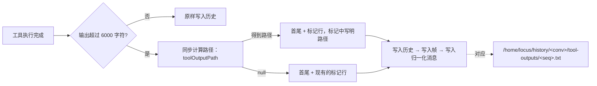

# 上下文管理：设计

状态：第 3 版，已由所有者批准（2026-10-17）。第 2 节的原则作为 D9 记录在 [DECISIONS.md](DECISIONS.md)；所有者的决定见第 6 节。
代码基线：locus-runtime `a1921cf`、locus-harness `aa45eeb`、locus-product `f215a1d`。下文行号均为约数，以函数名为准。
第 2 版吸收了一轮独立审查的结论：落盘方案改为复用已有的历史视图，同时更正了第 1 版中的若干事实错误。

本设计解决四个问题：
- 长任务撞上请求体积上限后直接失败
- 裁剪历史时破坏提示词缓存
- 重载后第一次裁剪会一次丢光恢复的历史
- 工具输出被截掉的中间部分，模型实际上拿不回来

本设计不做：
- 让模型生成摘要：多一次付费调用，而且破坏回放保真度
- 跨对话的记忆
- 按模型名推断上下文窗口：D5 禁止

---

## 0. 现状（代码事实）

### 0.1 历史的存储与持久化

`AgentSession.history` 是一个数组（harness `src/agent.js`），每条记录在写入时就定型：

| 内容 | 写入位置 | 形状 | 持久化帧的 raw |
| --- | --- | --- | --- |
| 用户任务 | `run()` 约第 819 行 | `{role:'user', content, _taskStart:true}` | 另外构造的新对象，`kind:'user'`（`provider-session.js` 的 `onUserMessage`） |
| 助手回复 | 约第 994 行 | provider 原生对象，原样存入（含 thinking、签名、未知字段），回放时逐字节重发 | 与历史条目是同一个对象 |
| 原生工具结果 | 约第 1150、1189、1235 行 | `{role:'tool_result', toolCallId, toolName, content, success}` | 与历史条目是同一个对象 |
| 文本回退工具结果 | 约第 1106 行 | `{role:'user', content:'<tool_result>…</tool_result>'}` | 另外构造的新对象，`kind:'tool_feedback'` |

product 的 PersistenceService 在每次写入和读取时都会深拷贝（`persistence.js` 的 `persistenceClone`、`_redact`）。所以在 product 里，原地修改历史条目**不会**改到已经写入的持久化记录。但 harness 的测试替身和其他内存实现可能持有引用，所以本设计仍然要求 copy-on-write。

工具输出写入历史前要经过 `truncateFor(output, 6000)`，保留开头三分之一和结尾三分之二。完整输出存在归一化消息的 `toolResult` 字段里（约第 1113、1250 行）。product 把归一化消息以 `/home/locus/history/<conv>/messages.jsonl` 的形式只读挂载给模型（`conversation-history-workspace.js`），所以**理论上**模型能找回被截掉的部分。但实际很难用：整个对话只有一个文件，内容是转义过的 JSON，很快就会超过 `cat` 的 512 KiB 和 `grep` 的 2 MiB 上限。

### 0.2 预算与裁剪

- `HISTORY_BUDGET_BYTES = 768 KiB`（约第 41 行），是常量，不可配置。注释说明设成这个值是为了低于 `/proxy` 的 1 MiB 请求体上限。
- `_requestBytesFor()`（约第 600 行）统计系统提示、每条历史 JSON 序列化后的字节数和图片估算，**但不统计 `request.tools` 的 JSON schema**。系统提示里只有工具的名称和描述。
- `enforceHistoryBudget()`（约第 647 行）在每轮模型调用前运行：从最旧的任务开始，以 `_taskStart` 为边界整块删除，直到刚好低于预算；如果只剩当前任务仍然超出，就报错 `history_budget`，任务失败。

这套机制有三个问题：

1. **缓存反复失效。** 每次裁剪都会改变请求前缀；历史一旦接近预算，之后几乎每一轮都要再裁一次。
2. **恢复的历史缺少任务边界。** 恢复出来的历史没有 `_taskStart` 标记，涉及三条路径：`restoreInto` 中的原始帧路径（`provider-session.js` 约第 144 行）、`restoreInto` 中的两个投影分支（约第 162、175 行），以及 product 切换 provider 时的投影（`store.js` 约第 1433–1446 行）。`projectNormalizedHistory` 会丢掉 `kind` 字段，所以补标记只能在投影函数内部完成。结果是：重载后第一次裁剪时，所有恢复的历史会被一次性删光。
3. **单个任务超出预算时没有退路。** 这种情况主要来自助手内容：推理过程、工具调用参数里的大段代码。工具结果反而不是主因，因为每条最多 6000 字符，一个任务最多 32 次调用。

product 提交任务前有一道预检（`store.js` 约第 1197 行）：它统计的是**未经裁剪**的整个历史，再加上图片，所以会拦下那些裁剪之后其实放得下的任务。而且它用的是不带参数的 `historyRequestBytes`，工具快照为空。

### 0.3 缓存

现在没有任何代码发送 `cache_control`。DeepSeek、OpenAI 这类端点会自动按前缀缓存，所以前缀稳定直接有收益。Anthropic 官方端点需要显式的缓存断点，没有断点就不会缓存（见第 7 节）。

### 0.4 传输路线

harness `src/model.js` 的 `tryFetch`：用户配置了 proxy，就走用户的 proxy；否则先直连，只有遇到网络或 CORS 错误、并且页面不是 `file:` 时，才回退到同源的 `/proxy`（product `functions/proxy.js`，请求体默认上限 1 MiB，可以用环境变量修改）。请求发出前无法知道最终会走哪条路线。

### 0.5 文件系统

- runtime 的默认挂载全部是内存型；product 在启动后把 `/home/locus` 换成 OPFS，并把 `/home/locus/history` 挂成只读的 IndexedDB 视图（`store.js` 的 `mountDurableStorage`）。
- 嵌套挂载只出现在它的直接父目录的列表中，而且父目录本身必须是挂载根或者结构目录（`vfs.js` 的 `list()`）。`/home/locus/history` 已经是这样的嵌套挂载。
- Python 只同步五个根挂载，所以 `/home/locus/history` **对 Python 不可见**（`vfs.js` 的 `dataMounts()`）。
- 模型读文件时的上限：`cat` 512 KiB；`head`/`tail` 输入 16 MiB、输出 512 KiB；`grep` 单文件 2 MiB（严格大于才跳过）；管道 1 MiB；`cp` 单个文件没有命令层上限，只受目标位置限制（`/tmp` 是内存型，单文件 16 MiB）。
- `cat` 和 `head`/`tail` 超限时的报错会建议“use python”。

### 0.6 harness 与文件系统

`AgentSession` 本身从不读写文件。harness 中唯一接触文件的是 CapabilityManager，它通过 product 注入的存储端口读写 skill 实例（`extension-composition.js` 约第 704–799 行）。这正是本设计要沿用的先例。

---

## 1. 目标

1. 长任务不再因为超出体积上限而直接失败，除非确实无路可退。
2. 正常情况下历史只追加，前缀稳定；不得不裁剪时，一次裁够，不要每轮都裁。
3. 被截掉的工具输出可以完整取回，模型用普通的 shell 命令就能读到。
4. 重载前后行为一致：恢复的历史有正确的任务边界，历史里引用的输出文件依然存在。
5. 不破坏现有的回放与持久化不变量（第 4 节）。

---

## 2. 设计原则（D9）

按 D8 归类：四条都属于 B 类，也就是承载跨 agent 共识的显式契约。正式写入 DECISIONS.md 时，按固定格式整理成“决定 / 理由 / 影响范围 / 被取代的旧表述”。

1. **只追加。** 一条历史记录的内容在写入那一刻定型，之后不再修改。唯一的例外是超预算时的检查点式处理（第 3.3 节）：一次处理到低水位线，并且只用 copy-on-write 替换，绝不原地修改。
2. **历史引用的文件与对话同寿。** 历史中出现的文件路径，在对话存在期间必须一直能读到。
3. **harness 只通过端口接触文件和存储。** 是否截断、标记怎么写由 harness 决定；文件放在哪、怎么存由 product 决定。
4. **预算 = min(传输上限, 上下文上限)。** 上下文上限来自用户配置，并用 provider 返回的 usage 校准；不按模型名推断（D5）。

---

## 3. 设计

### 3.1 被截断的输出：用历史视图中的虚拟文件取回

完整输出本来就保存在归一化消息里，所以不需要再拷贝一份。在已有的 `/home/locus/history` 视图中，给每条工具输出增加一个虚拟文件：

```
/home/locus/history/<conversationId>/tool-outputs/<sequence>.txt
```

`<sequence>` 是这条工具结果的归一化消息序号，在同一个对话中唯一。



这个方案的好处：

- 不额外存储任何数据，也就不需要配额
- 清理现成：删除对话或清空对话时，归一化消息一起删掉，文件也就跟着消失了
- 脱敏现成：归一化消息写入时已经经过 `_redact`
- 内存模式下也一致：历史和文件同生同灭，不会留下指向不存在文件的路径
- 不会产生孤儿文件

#### 序号怎么在写入之前就确定

**写入顺序是固定的**（`provider-session.js` 的 `makeContext`）：助手帧带有 `rawResponse`，写它的时候会先写一条助手的归一化行；然后每条工具结果依次是“写帧（不产生归一化行）→ 写归一化行”。整个任务循环是串行 await 的，中间不会插入别的归一化写入。所以在写入一条工具结果之前，“下一个归一化序号”就是这条结果将来的序号。

具体改动：

- `makeContext` 返回的持久化上下文增加一个同步方法 `peekNextNormalizedSequence()`，返回 `normalizedSequence + 1`
- `run()` 增加一个可选参数 `toolOutputPath`，由 product 提供，签名为 `({ sequence, toolCallId, toolName }) → string | null`，**必须是同步函数**
- harness 在写入工具结果之前计算路径：持久化上下文和 `toolOutputPath` 都存在时，才调用 `toolOutputPath({ sequence: peekNextNormalizedSequence(), ... })`，否则路径为 `null`

**全程同步，没有 await。** 现有代码是先检查 `sessionChanged()`、再同步写入历史；这一步不能插入 await，否则会话切换时，旧任务的结果可能被写进新会话的历史。

如果之后的持久化写入失败，路径指向的文件就不会存在。但这种情况下任务本来就会以 `persistence_error` 结束，对话也会被标记为降级，可以接受。

#### harness 侧的改动

- `truncateFor(s, max, note)` 增加可选的第三个参数，用来替换标记行的文字。不传 `note` 时，标记行与现在逐字相同，现有的 TR1–TR4 测试不受影响。
- 有路径时，标记行为：

  ```
  ... [truncated N chars in the middle; full output: /home/locus/history/<conv>/tool-outputs/<seq>.txt — use head/tail/grep -n, or cp it to /tmp to use it from python] ...
  ```

  没有路径时，保持现在的标记行不变。
- 原生工具结果和文本回退两条路径都要处理。
- 有路径时，在历史条目上记录内部字段 `_outputPath`（供第 3.3 节使用）。它以下划线开头，会被 `stripInternalFields` 从请求中去掉。原生结果的帧与历史条目是同一个对象，所以这个字段会跟着帧一起保存；文本回退的帧是另外构造的对象，不带这个字段，这不影响正确性，只是第 3.3 节省略这类条目时，stub 中不会附带路径。
- 在 `harnessCapabilities()` 中声明这项能力（见第 3.4 节）。

#### product 侧的改动

- 在 `ConversationHistoryWorkspace` 中：
  - `list('<conv>')` 增加一个目录项 `tool-outputs`
  - `list('<conv>/tool-outputs')` 列出该对话中所有 `kind:'tool_result'` 的归一化行，文件名为 `<sequence>.txt`
  - `read('<conv>/tool-outputs/<n>.txt')` 返回第 n 条归一化行的 `toolResult` 原文；该行不存在、或者不是工具结果时，抛出 NotFoundError
  - `stat` 返回准确的字节大小。现有实现会读出整个文件来计算大小，这对单条输出是可以接受的
- `toolOutputPath` 的实现：持久化可用时（IndexedDB 模式或内存模式都可以，因为两种模式下历史和文件同生同灭），返回 `/home/locus/history/<当前对话 id>/tool-outputs/<sequence>.txt`；否则返回 `null`
- 只在 harness 声明支持这项能力时，才把 `toolOutputPath` 传给 `run()`，并在 `src/ui/product-prompt.js` 的 `locusEnvironmentNotes` 中加入一条：

  `- When a long tool output is truncated, the truncation marker may name a file under /home/locus/history that holds the full output (read-only). Read it with head/tail/grep -n; to process it with python, cp it to /tmp first.`

  prompt parity 测试只做包含性检查，新增一行不会让它失败。

#### 已知的局限

- **Python 看不到这些文件**，因为它们在嵌套挂载里。模型需要先 `cp` 到 `/tmp`，环境说明中已经写明。
- 超过 512 KiB 的输出不能直接 `cat`，而 `cat` 的报错会建议改用 Python，这条建议对这些文件不适用。可以考虑之后让 runtime 的报错改为“use head/tail or python”，但不在本设计范围内。
- `grep -r` 和 `find` 搜索 `/home/locus` 时会进入 `history/`，这个问题现在就存在；新增的文件会让搜索结果更嘈杂。

### 3.2 预算

**阶段 1：修正统计，并让预算可配置**

- `_requestBytesFor()` 加上 `promptInput && promptInput.tools ? JSON.stringify(promptInput.tools) 的 UTF-8 字节数 : 0`。**必须做空值保护**，因为 `agent-image.test.mjs` 约第 398 行会以 `null` 调用它。
- 新增 `session.setRequestBudget(bytes)`，参数必须是正整数，默认值仍为 768 KiB；与 `maxTokens` 一样，在任务开始时做快照。
- 新增 `session.requestBudgetBytes()`，返回当前预算。导出的 `historyBudgetBytes()` 保持不变，以免破坏 harness-boundary 测试锁定的导出名。
- 新增 `session.minimumRequestBytes(workspace, taskEnvironment, extraBytes)`：模拟“丢弃所有旧任务”之后的最小请求字节数，也就是系统提示加工具 schema，再加上调用方传入的新一轮用户消息的字节数。product 的预检改为只在这个值超过实际预算时才拦截。这样预检和运行时的裁剪规则就一致了。

**阶段 4（可选，需要所有者决定）：上下文上限**

- product 设置中增加一个可选项“上下文窗口（tokens）”，默认为空，表示未知，此时只受传输上限约束。
- 先在 adapter 层统一 usage 字段：
  - OpenAI 方言：用 `prompt_tokens`
  - Anthropic 方言：`input_tokens + cache_read_input_tokens + cache_creation_input_tokens`
- 用统一后的输入 token 数校准“字节 / token”比例。计算时**扣除图片的估算字节**，因为图片 base64 的字节数和 token 数没有固定比例。取最近几次的移动平均，并限制在 1 到 6 之间；还没有测量值时，用保守值 2。
- 上下文对应的字节上限 = `(上下文窗口 − maxTokens) × 比例 × 0.9`；最终预算 = min(传输预算, 上下文字节上限)。
- 这是测量，不是按名推断，符合 D5。

传输预算本身暂时不用变：只要页面不是 `file:`，直连失败后都可能回退到 1 MiB 的 `/proxy`，768 KiB 一直是合适的保守值。

### 3.3 超预算时的阶梯处理

每轮模型调用前，按顺序执行下面几级，任何一级达标就停止：

1. **没超预算**：什么都不做。这是常态：历史只追加，前缀稳定。
2. **丢弃旧任务，一次到低水位**（阶段 1）：从最旧的任务开始整块丢弃，直到低于预算的 **60%**，或者只剩当前任务为止。比起现在“刚好低于预算就停”，一次多裁一些，换来之后很多轮都不用再裁、前缀保持稳定。
3. **省略当前任务内旧的工具结果**（阶段 3）：
   - 候选：当前任务内的工具结果条目（`role:'tool_result'`，以及以 `<tool_result>` 开头的文本回退条目），**跳过最近的 4 条**，从最旧的开始
   - 用 copy-on-write 替换：`this.history[i] = Object.assign({}, entry, { content: stub, _elided: true })`
   - stub 的内容：有 `_outputPath` 时为 `[earlier tool output elided to fit the request budget; full output: <path>]`，没有时为 `[earlier tool output elided to fit the request budget]`
   - 同样处理到低水位为止
   - **助手消息永远不动**，其中的 thinking 和签名必须逐字节回放
   - 这一级的收益有限，因为单个任务超预算主要来自助手内容；它只能救一部分情况
4. **仍然超出**：报错 `history_budget`，与现在一致。

**补回恢复历史的任务边界**（阶段 1）：

- `restoreInto` 的原始帧路径：对 `kind === 'user'` 的帧，用 `Object.assign({}, f.raw, { _taskStart: true })` 复制一份，其他帧原样使用。
- `projectNormalizedHistory`：在投影函数内部，为 `role:'user'` 且 `kind:'message'` 的行生成的消息加上 `_taskStart: true`。这样 `restoreInto` 的两个投影分支，以及 product 切换 provider 时的投影，都会被覆盖到。

---

### 3.4 契约与能力声明（D6）

- harness 在 `harnessCapabilities().capabilities` 中声明三项：`requestBudget`（`setRequestBudget`、`requestBudgetBytes`、`minimumRequestBytes`、低水位和省略）、`toolOutputPath`（运行参数、`peekNextNormalizedSequence`、投影参数）、`contextWindowBudget`（上下文窗口与校准）。
- product 在兼容性检查（`src/product/core-compatibility.js`）中把这三项都列为**可选**能力，各自的降级规则是：没有 `requestBudget` 时，预检沿用旧的计算方式；没有 `toolOutputPath` 时，不传 `toolOutputPath`，环境说明里也不加那一条；没有 `contextWindowBudget` 时，不调用上下文窗口相关的方法，设置项保存但不生效。这样就不会出现环境说明承诺了完整输出、实际上 harness 却没有生成路径的情况。

---

## 4. 与回放和持久化的关系

| 不变量 | 本设计如何保证 |
| --- | --- |
| 助手帧逐字节回放 | 任何一级处理都不修改助手消息 |
| 工具调用与结果成对出现 | 丢弃只在 `_taskStart` 边界整块进行；省略只替换 content，不删除条目 |
| 不原地修改历史条目 | 所有替换和补标记都用 copy-on-write |
| 回放校验 | 校验器不检查工具结果的 content（`replay-validation.js`），标记行不影响校验 |
| 重载后路径仍然有效 | 路径指向的是从归一化消息派生的视图，归一化消息与对话同寿 |
| 会话切换时不串写 | 计算路径是同步的，“检查会话 → 写入历史”之间没有 await |

重载后的裁剪结果**不一定**和重载前逐字相同：重载前的裁剪是逐步累积的，重载后则是对完整的恢复历史一次性裁剪。但两者遵守同样的规则，结果都满足预算，工具调用和结果也都保持成对。

---

## 5. 实施拆分

共 6 个 PR，分三波。同一波内的 PR 互不依赖，可以并行。

| 波次 | PR | 仓库 | 内容 |
| --- | --- | --- | --- |
| 1 | H-A | harness | 阶段 1 与阶段 3：预算统计包含 tools；`setRequestBudget` / `requestBudgetBytes` / `minimumRequestBytes`；丢弃到低水位；当前任务内工具结果的省略；`restoreInto` 的原始帧路径补回 `_taskStart`；能力 `requestBudget` |
| 1 | H-B | harness | 阶段 2 与投影修复：`peekNextNormalizedSequence`；`toolOutputPath` 运行参数；带路径的截断标记与 `_outputPath`；`projectNormalizedHistory` 补回 `_taskStart`、恢复“不可信数据”框定并截断、文本回退结果投影为原来的 user 文本；`validateNormalizedPrefix` 接受文本回退结果；能力 `toolOutputPath` |
| 1 | P-0 | product | 本文档与 D9 |
| 1 | P-1 | product | `ConversationHistoryWorkspace` 增加 `tool-outputs/`；导出路径工具函数 |
| 2 | H-C | harness | 阶段 4：usage 统一、上下文窗口设置、字节/token 校准、实际预算取较小值；能力 `contextWindowBudget`。依赖 H-A |
| 3 | P-2 | product | 升级 harness；兼容性声明三项可选能力；预检改用 `minimumRequestBytes`；接入 `toolOutputPath` 与投影参数；环境说明；“上下文窗口”设置；更新相关文档。依赖以上全部 |

需要同步更新的文档（在 P-2 中完成）：

- `MODEL-PROTOCOL.md`：增加“历史预算与缓存”一节
- `PERSISTENCE.md`：在 `/home/locus/history` 的说明中加入 `tool-outputs/`
- `LINUX-LIKE-VFS.md`：新增的路径
- `IMAGE-INPUT.md`：“请求预算”一节改为引用本文
- `REPOSITORY-SPLIT-CONTRACTS.md`：新的运行参数、持久化上下文方法、投影参数和能力声明

---

## 6. 所有者的决定（2026-10-17）

- **Q1 Python 是否直接看到这些文件**：不改 runtime，模型先 `cp` 到 `/tmp`。
- **Q2 低水位**：预算的 60%。
- **Q3 阶段 3**：做。
- **Q4 阶段 4**：做。
- **Q5 D9**：第 2 节写入 DECISIONS.md。

---

## 7. 已知但不在本设计范围内

- **Anthropic 官方端点的缓存断点。** 现在没有任何代码发送 `cache_control`，所以 Anthropic 官方端点上的前缀缓存实际不会生效；本设计带来的前缀稳定，目前只对自动缓存的端点有收益。可以之后在 Anthropic adapter 中为稳定前缀加断点，是否启用按 provider 能力决定（D5）。
- **删除单个对话的界面。** product 没有这个界面；`deleteConversation` 目前只有测试在调用。
- **附件回收。** 附件存储（`attachments/`）是全局、按内容寻址的，没有引用计数，也没有回收机制。
- **runtime 的 `cat` 超限提示。** 报错建议“use python”，对 `/home/locus/history` 下的文件不适用。

第 2 版曾列在这里的两项已并入 H-B：跨 provider 投影的问题（完整输出、丢失框定、文本回退结果被投影成 `toolCallId` 为空的原生结果），以及文本回退模式的归一化校验。后者已确认是 bug：文本回退的工具结果行没有 `toolCallId`，`validateNormalizedPrefix` 必然报 `normalized_tool_result_invalid`，所以用过文本回退的对话在切换 provider 后会被锁定为不可回放。
